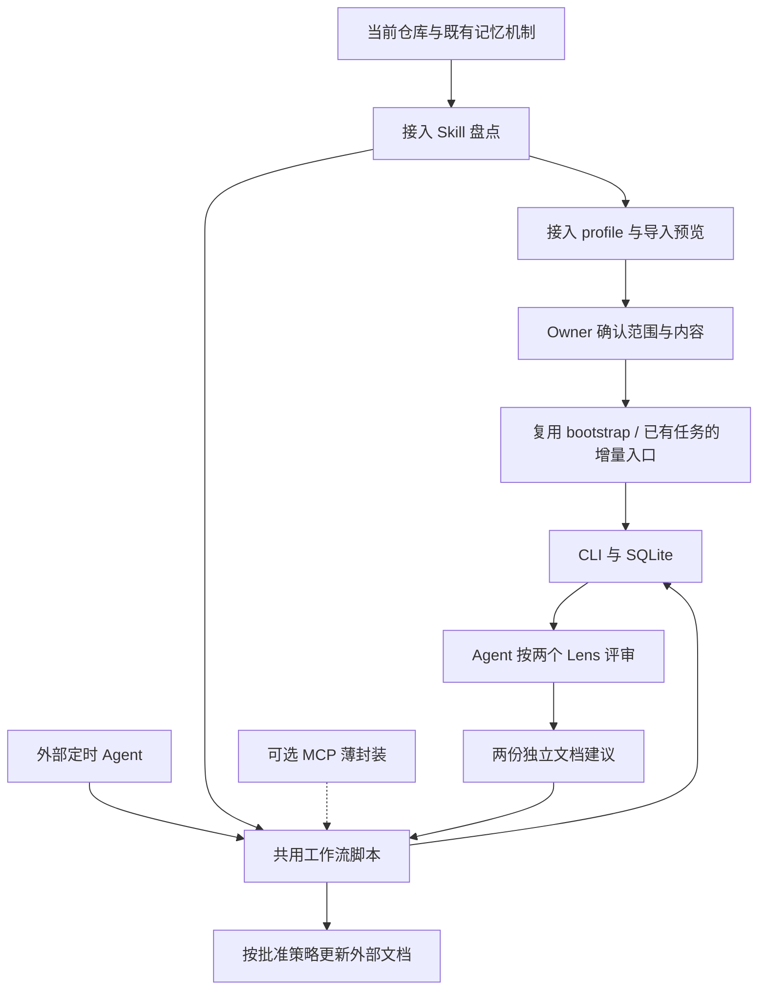

# ADR-029: 仓库记忆接入与可重复执行的工作流

## 状态

**行为方案已获 owner 接受，2026-10-22；实现按 R1–R6 分阶段推进。**

本次接受的是职责、流程和验收边界。精确 CLI/JSON/schema 仍由 R2 交付并审阅；本 ADR
不表示增量、独立采纳或脚本已经实现，也不授权迁移生产账本或启用真实定时任务。

根据 owner 的补充，本稿取代本分支尚未发布的“固定 PROGRESS.md / WORKFLOW.md”方案。
首个验收仍是一个仓库、一份条目草稿箱、两个 Lens、两份外部文档；具体文件、规则和
调度入口由接入 Skill 识别并建议。内核保存通用记忆与消费关系，脚本执行已定义的流程。

- 工作流程、职责及验收见 [行为合同](../docs/repository-memory-workflows-contract.md)。
- 实施顺序见 [issue 索引](../docs/repository-memory-workflows-issues.md)。
- 收集真实样本时使用 [MiniMax 只读盘点 prompt](../docs/handoffs/minimax-repository-memory-discovery.md)。
- 源码基线 main `a417835`，沿用 ADR-027/028 的 Rust CLI、SQLite、单 owner 边界。
  #301 与 #283 保留独立验收；本方案不代表真实客户端或调度已通过。

## 背景

owner 的不同任务目录已有不同的知识与记忆机制：文档、草稿箱、Agent 指令、会话记录和
定时 review。接入 MemoryNexus 应先理解这些机制，再确定一次性导入和日常增量流程。
仅凭文件叫 MEMORY.md 或 PROGRESS.md，不能确定它的权威性、有效性或维护方式。

现有 bootstrap Skill 已提供来源盘点、有限 seed、精确预览确认、CLI 导入和中断恢复，
但只适用于首次初始化；它不会追踪后续文件变化，也不支持重新初始化已有 task。
当前 task review 有候选及来源失效机制，尚无按多个 Lens 独立消费的完整关系。

真机备份脚本的演进也说明：稳定路径、固定入口、分路失败隔离、可读运行结果需要成为
可交付脚本的合同。将脚本纳入版本管理有价值；现有在用备份脚本的迁移另行评估。

## 决策

### 1. 三层职责：Skill 制定流程，脚本执行，CLI 保存记忆

| 层 | 负责 | 边界 |
| --- | --- | --- |
| Skill / Agent | 识别任务、盘点既有机制、判断来源、抽取有限内容、运行 Lens、提出文档建议 | 模型判断及仓库语义在这一层；原文指令不是执行授权 |
| 仓库接入脚本 | 按批准的 profile 选源、计算变化、预览、调用 CLI、校验回执、维护外部文档与运行报告 | 版本化、可重试的短进程；只使用受限操作，不接受任意命令 |
| Rust CLI + task SQLite | task 身份、记录/候选、来源版本、独立消费关系、幂等、失效及恢复 | 不理解特定文档名，不读取仓库文件，不调用模型或调度任务 |

脚本调用公开 CLI，不直接写 SQLite。它可以保存 private preview、未确认请求及文件应用
日志；这些是待执行工作或运行证据，不成为另一份权威记忆数据库。已确认的来源映射、
Lens 消费决定和幂等回执必须能从 task ledger 恢复。

### 2. 接入从发现开始，输出可审阅的 profile

profile 描述任务目的、已有机制、来源优先关系与缺口、允许路径、首次 seed、增量触发、
Lens 和输出映射、确认策略，以及调用所需的 config/ledger/binary 绑定。
共享规则可随项目走；机器路径、私有内容和运行产物留在 owner-only 的部署目录。
新 profile 不向严格的 `.memorynexus.json` 塞入未支持字段。

首版只选择一个真实仓库中的少量本地文本来源。Git 状态是可选证据，不要求每个任务都是
Git 仓库，不全盘扫描 home，也不先构建仓库分类器或通用连接器框架。

### 3. 区分外部知识、任务记忆与派生文档

README、ADR、WORKFLOW、PROGRESS 或任意名称的文件都是外部知识。Skill 判断它们
在本任务中的用途；原文继续由原仓库维护，MemoryNexus 保存有限条目和可核对的来源。
权威关系按具体事项说明，冲突不能只按文件名或修改时间自动裁决。

Lens 是版本化评审规则；输出目标用不透明的 consumer ID 表示。规则、文档路径与渲染
模板属于接入层，内核不内置 progress/procedure 类型或 Markdown writer。
PROGRESS.md / WORKFLOW.md 可以作为演示，换成别的文件无需修改 Rust 分支逻辑。

派生文档的受管区域默认排除增量采集，防止“生成 → 再导入 → 再确认”的循环。确需引用
人工维护区域时，profile 明确段落范围；保留原来源链，不将派生文本当成独立佐证。

### 4. 首次导入复用现有能力，增量单独定义

- 首次接入：复用 bootstrap manifest/preview/apply/resume，不另写一套导入器。
- 已有 task：核对绑定和当前状态，进入增量流程；不重新 init、不重复 seed。
- 增量：脚本识别来源版本变化，Agent 按 profile 抽取有限条目；CLI 校验并提交。
- 无新来源、无待处理失效或恢复工作：返回 no-op，不调用模型或改写文档。

来源身份与版本分别保存。路径移动不自动成为新知识，较早发生的事件也不能因为时间
游标而漏掉。无法读取文件与已确认删除是不同状态。profile 明确支持范围外的变动时，
返回待核对状态，不能静默当成空输入。

观察到文件变化可以使该来源派生结果失效；这不等于 owner 确认了替代内容。现有
`correct` / `retract` / instruction 的逐次确认语义保留。新增的自动来源失效需在新合同
中显式定义，不通过伪造 `confirmation` 或滥用 `correct` 实现。

### 5. 独立采纳、重试和纠正是通用合同

消费唯一性按 `(task, consumer, lens_version, source_entry, source_revision)` 约束，
不设来源级全局 processed。两个 Lens 可以分别采用、跳过或暂缓，同源可采用不同措辞。
新 run/client/key 不产生第二份业务结果；相同来源下改变措辞需要显式重新评审。

每个决定分别记录决定、来源有效性和发布状态。来源变化后，旧批准失效，新版本重新
进入各消费者的待评审集合。文档采用不会把源条目升级为 owner-confirmed。

内核事务处理来源与消费状态；外部文件更新有独立完成点。脚本写入前复查来源、批准与
文件基线，采用受管区块和可恢复操作；人工改动冲突时保留现场。纠正发生后文档可能
暂时仍旧，status 必须暴露这一差异。新结论默认精确确认后发布；撤下失效正文的中性
提示替换也需要接入时明确授权。不能承诺两个文件与 SQLite 共同原子提交。

### 6. 收纳可执行脚本，外部调度只负责唤起

共用脚本随 Skill/接入包版本管理并安装到稳定路径，任务配置绑定版本与摘要。定时
Agent、交互式 Skill 和未来 MCP 都调用同一实现，运行时不临时重写逻辑。

脚本提供选源、准备、预览、应用和状态查询等有限操作。需要自然语言判断时返回有来源
的 work items，由调用 Agent 按 Skill 评审后提交；脚本不内嵌模型 SDK 或 Agent runtime。
备份等完全确定性的流程可以一次运行完成，两类流程共享报告和部署约定即可。

第一版接入 owner 指定的外部调度入口；schedule、唤起、超时和是否补跑由该调度器负责。
MemoryNexus 不引入 scheduler/daemon。运行报告分别说明手动调用、scheduler run 证据、
各分支结果和未完成项；手动成功不能证明定时成功。

MCP 是后续可选的薄调用层，只暴露已验证操作、结构化参数和结果，不提供任意 shell。
它不绕开批准、幂等、路径限制或版本绑定，也不恢复旧 Lens/MCP 后端。

### 7. 按证据扩展内核，先冻结缺失合同

现有 CLI 不接受任意 kind、Lens 或 metadata 字段；evidence_refs 也不监控来源文件。
不能仅用脚本就声称实现了持久化的独立采纳与自动失效。

先完成来源身份/版本、草稿 trust、消费者决定及发布回执的精确合同，再实现最小 Rust
扩展。复用现有记录与 revision/receipt 机制，是否需要新表由该合同决定，不提前建设
文档平台。涉及 schema 变化时须显式迁移、兼容性和备份恢复设计；读取不得触发升级。
所有客户端和备份入口的 pinned binary 都须列入部署核对。

## 最小交付与非目标

先交付接入 Skill 的盘点/profile，再复用 bootstrap 打通首次导入；随后补齐通用来源与
消费合同、增量脚本、两个配置化 Lens 和受管文档输出，最后接外部定时入口。MCP 与
现有备份脚本收编可单独推进，不成为首个闭环的依赖。

首个闭环必须证明：独立采纳、无变化不重复、来源纠正后的失效与更新、跨进程恢复，
以及真实调度调用同一脚本。仅展示脚本执行或两份文档生成不构成验收。

本方案不涉及通用 ETL、自动代码执行、跨项目归纳、全仓全文入库、第二数据库后端、
自动 Git 提交或旧 Lens 服务。当前真机备份 cron 和已删除 review cron 不因本提案变更。
